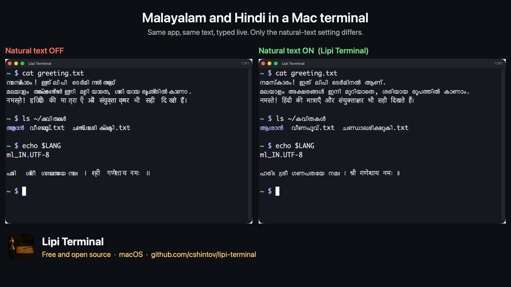

# Lipi Terminal


Lipi Terminal is an experimental [iTerm2](https://iterm2.com) fork for macOS that
renders Malayalam and Hindi with naturally shaped text.



## Install

1. Download `Lipi-Terminal-macOS-arm64.zip` from
   [Releases](https://github.com/cshintov/lipi-terminal/releases). The ZIP is for
   Apple silicon Macs. Compare its SHA-256 with the one in the release notes.
2. Unzip it and move **Lipi Terminal.app** to Applications. Leave your existing
   iTerm2 installed.
3. Lipi is ad hoc signed, not Developer ID signed or notarized. If Finder offers
   **Open** in the right-click menu, try opening it there. If macOS blocks the
   first launch, see [Apple's per-app Open Anyway instructions](https://support.apple.com/en-us/102445).
   Only proceed if you trust the download. Do not turn off Gatekeeper globally.

## Enable natural text

In **Settings > Advanced**, search for the setting names below. Start a new
session after changing a natural-row option. Enable the Malayalam or Hindi
switch for the script you want; both are off by default.

| Setting | Default | Purpose |
| --- | --- | --- |
| `MalayalamNaturalRows` | Off | Natural Malayalam text and native caret geometry. |
| `HindiNaturalRows` | Off | Independent opt-in for natural Devanagari text. |
| `HindiNaturalRowsFont` | `DevanagariSangamMN` | Hindi-only font override. Empty means Automatic; an unavailable font uses the existing fallback. |
| `MalayalamVisualWrap` | Off | Experimental visual wrapping, including enabled Hindi rows. |
| `MalayalamParagraphFlow` | Off | Heuristic joining of likely client-painted prose continuations. |

Natural rows use the **legacy renderer**, not Metal. The Hindi font override
keeps the profile's point size and does not change its ASCII or Malayalam font.
Choose an installed Malayalam-capable non-ASCII profile font for Malayalam.
Fonts can change wrapping and caret geometry, so compare actual text before
adopting a different face. The exact-cell inspection strip is a separate,
development-only option and is off by default.

Some setting and class names retain “Malayalam” for compatibility even where
Hindi uses the same path. The two script switches remain independent. Enabling
natural rows affects supported attached-mark cell ownership for newly received
text; changing a font cannot recover text already overwritten by an earlier
client redraw.

## What has been checked

Integrated native tests exercise parser cells, captured positional terminal
updates, natural shaping, wrapping, selection/copy, font fallback and changes,
scrolling, and client mouse-report routing. Claude Code has been used for live
checks and captured-output replay. Tests and offscreen images are evidence for
those cases, not a guarantee for every reply or client version.

Codex/tmux rendering is **not yet optimal**: unwanted gaps and broken words have
been reported and remain a known compatibility issue. Claude Code results do
not establish Codex support.

## Known limits

- Unsupported row content or screen layouts may fall back to the ordinary grid.
- Natural rows can slow down long output and large selections.
- Pointer movement can sometimes make the view jump when an app requests
  hover reports. The underlying cause is still under investigation.
- Paragraph joining is intentionally conservative. It must preserve headings,
  blank lines, list boundaries and original source coordinates.
- Natural wrapping changes presentation, not the coordinates a terminal client
  sends. Full-screen applications can impose incompatible layout assumptions.
- Responsive Unicode box tables have bounded coverage, not universal TUI support.
- Local text selection uses native cluster edges. Client mouse reports and
  keyboard movement still need exact logical cells. Successful protocol replay
  alone is not physical mouse or trackpad acceptance.
- Some redraw artifacts remain under investigation; clean replays do not
  establish every live redraw.
- No universal Unicode, arbitrary-font, accessibility or no-lag claim is made.

## Build and isolation

Use the fork-specific entry point with full Xcode, a clean committed checkout
and the project's dependencies already prepared. The builder exports exact HEAD,
not uncommitted edits. The output must be a new or empty directory outside the
checkout. Supply an existing Xcode SourcePackages directory with workspace state
and clean checkouts at the exact Package.resolved revisions. For example, using
prepared sibling directories:

```bash
tools/build-lipi.sh \
  --output ../lipi-output \
  --source-packages ../existing-source-packages-cache
```

The result is `../lipi-output/Lipi Terminal.app`. Use `--developer-dir` to select an
Xcode Developer directory for this build without changing global selection.
The script does not install prerequisites or download dependencies. Use populated
pinned submodules. If absent, provide existing pinned checkouts through
`--noise-source` and `--shell-integration-source`. These are source inputs, not
download locations. Upstream dependency/setup documentation remains in the
repository; review it before allowing installations or privileged changes.

The builder exports the committed source and privately copies the package cache
into the output directory. It validates pinned revisions before building an
unsigned, host-architecture Development app with optimization and assertions.
The output also contains `build.log`, `build-receipt.json` and `app-manifest.json`.
It does not install or launch the app, fetch dependencies, use signing credentials,
or write global settings. That is a build-script boundary, not a claim that the
running terminal has no network features or shared services. The Lipi package
uses its own app icon; upstream app-icon artwork is not used for the Lipi icon.

Lipi uses the separate bundle identifier `io.github.cshintov.lipi-terminal` and
its own preferences identity. The Lipi package removes the upstream automatic
update feed and key; there is no Lipi update service. Internal executable and
helper names may still say iTerm2. Do not replace a working iTerm2 app, import its
preferences over an existing setup, or infer complete isolation of every
upstream service from the different app name.

### Upstream network paths

The following upstream product paths remain in the source. App replacement
updates and upstream crash submission are disabled in a Lipi build. Other rows
describe the existing feature gates, not features exercised by the build script.

| Feature | Upstream destination | Trigger or Lipi behavior |
| --- | --- | --- |
| App replacement | `iterm2.com/appcasts/*` | Disabled in Lipi, including manual checks; feed/key removed. |
| Crash submission | `iterm2.com/crashreportform.php` | Upstream crash reporting is disabled in Lipi. |
| AI model catalog | `iterm2.com/downloads/ai/manifest.json` | Automatic updates default off and require AI enablement/consent; manual catalog update exists. This is model data, not app replacement. |
| Python and uv provisioning | `iterm2.com/downloads/pyenv/{manifest,manifest-new,betamanifest}.json`, `iterm2.com/downloads/uv/manifest.json` | Runtime provisioning and rate-limited/user-requested update checks. Manifests can lead to executable runtime/package downloads. |
| AI and Companion plugins | `iterm2.com/downloads/ai-plugin/iTermAI-1.1.zip`, `iterm2.com/downloads/companion-plugin/iTermCompanion-1.0.zip` | Explicit optional feature installation downloads executable plugins. |
| Nerd Fonts | `iterm2.com/downloads/assets/nerd-fonts-v2.zip` | Explicit font installation asks for download permission. |
| Shell integration | `iterm2.com/shell_integration/v2/install_shell_integration.sh`, `iterm2.com/shell_integration/v2/install_shell_integration_and_utilities.sh` | Explicit download-and-run installation. It can intentionally modify shell integration files and shell startup configuration, not just Lipi preferences. |
| Companion connections | `relay.iterm2.com`, `resolver.iterm2.com/shardmap.json`, `push.iterm2.com`, `push2.iterm2.com` | Companion pairing, connection routing and notifications; separate from the app updater. |
| Browser help/support | `iterm2.com` documentation, bugs, credits, color gallery and feature-help pages | User-opened Help, tips and feature links retain upstream documentation. Report fork-specific defects to this repository. |
| API protocol name | `api.iterm2.com` | A WebSocket subprotocol identifier, not a network destination. |

This is the reviewed source-level upstream product inventory, not a full traffic
audit. User-configured AI providers, browsers, third-party frameworks and
installed plugins can contact other services. Disabling app updates does not
make the running application offline or isolate every optional feature's writes.

No published Lipi binary or clean-clone build result is claimed here. Public
release readiness requires the exact sanitized branch, native regression checks,
identity review and a successful clean-clone build.

## Upstream and license

Lipi is based on iTerm2 by George Nachman and its contributors. For general
upstream documentation, see [iTerm2 documentation](https://iterm2.com/documentation.html).
Fork-specific rendering problems should be reported to this repository, not
presented as bugs in an unmodified upstream installation.

The existing [LICENSE](LICENSE) contains GPL version 2, and [COPYING](COPYING)
states GPL version 2 or later. COPYING also notes that Apache 2.0 dependencies
make the combined distribution effectively GPL version 3. These files and
third-party notices are retained. See [NOTICE](NOTICE) for attribution.
